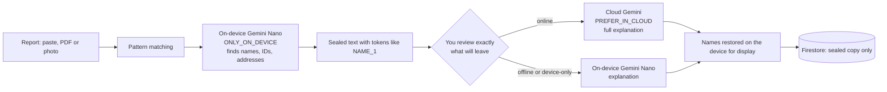

# Sealed

**A private health record for your family's lab reports.** Understand every report, track the values that matter across years and labs, and never give up anyone's identity to do it.

Live demo: https://rishinavroop22.github.io/sealed/

Sealed is a web app, an Android app and a Chrome extension for patients and families. It reads a lab report or prescription with an AI model that runs on the device, removes everything that identifies the person, shows exactly what is left, and only then sends that sealed version to a cloud model for a full plain-language explanation. In device-only mode, or with no network, nothing is sent at all.

Built for [#BuildHybridAI 2026](https://firebasehybridaihackathon.devpost.com/) with **Firebase AI Logic hybrid inference**.

## For judges: try it in 2 minutes

1. Open the [live demo](https://rishinavroop22.github.io/sealed/) in desktop Chrome. If the "On-device AI" chip is not ready, enable `chrome://flags/#prompt-api-for-gemini-nano-multimodal-input`, restart Chrome and let the model download once.
2. Click **Try with a sample report**. Watch the sealed text appear: the name, doctor, lab address and IDs are replaced by on-device AI plus pattern rules, and the proof line shows 0 cloud requests during sealing.
3. Click **Send sealed version for explanation**. Only the sealed text goes to Gemini in the cloud (shown word for word in the Privacy ledger). Switch the language to Hindi or Tamil and explain again.
4. Click **Save sealed copy to history**, then **Explain these changes** on the timeline: a sample family member already has two earlier reports.
5. Try **Share with a doctor** (a read-only link that expires in 7 days) and **Print for the doctor**.
6. Open the [sealing test](https://rishinavroop22.github.io/sealed/sealing-test.html): it runs the same sealing code on invented reports and shows every word it missed.
7. Click **Link a phone** and scan the code with the Android app or any phone's camera: the same sealed timeline appears there.
8. Turn on **Device-only mode**, or switch Wi-Fi off after the first load: sealing, explanation and questions still work on Gemini Nano.

## The problem

People increasingly paste lab reports into AI chatbots to understand them. Those reports carry a full name, date of birth, phone number, address, hospital ID and doctor's name, all sent to a server along with the person's health data. Most people either accept that or go without an explanation.

## Why hybrid matters here

In most hybrid apps the cloud is a fallback. In Sealed, the split between device and cloud **is** the product: the on-device model is the privacy gate in front of the cloud model.



| Step | Firebase AI Logic mode | Where it runs | Why |
|---|---|---|---|
| Read a photo or scanned PDF | `ONLY_ON_DEVICE` | Gemini Nano in Chrome | The image is never uploaded. |
| Find and remove identifiers | `ONLY_ON_DEVICE` | Gemini Nano in Chrome | The raw report must never leave the device, so there is deliberately no cloud fallback. |
| Full explanation | `PREFER_IN_CLOUD` | Cloud, else device | The larger model gives the best explanation and supports Indian languages, but only ever sees sealed text. Offline, the device model answers instead. |
| Quick questions | `PREFER_ON_DEVICE` (Remote Config) | Device, else cloud | Private, free and offline; falls back to the cloud on devices without a local model. |
| Device-only mode | `ONLY_ON_DEVICE` for everything | Device | For anyone who wants nothing sent at all. |

Every answer is labelled with where it ran (from `response.inferenceSource`), and the **privacy ledger** shows the exact text of anything sent to the cloud.

## What makes Sealed different

Many privacy tools hide names before text goes to the cloud. Sealed does that, and then does the health work only a dedicated app can:

- **Health timeline per family member.** Values such as HbA1c, creatinine, uric acid or ALT are matched across different labs' naming ("SGPT", "Alanine Transaminase") and tracked over years, with each report's own reference range shaded on the chart. Family members' names never reach the cloud, which sees an anonymous id and the month only.
- **One timeline on laptop and phone, linked by a QR code.** The code holds an unguessable id that works for 10 minutes, and the family's names. Names go from screen to camera and never through a server; only sealed reports are shared. The QR code is drawn by our own code, not a library or a service.
- **Critical-value alert before any AI.** Dangerous values (for example potassium above 6.2 or platelets below 50,000) trigger "contact a doctor today" from a fixed on-device check the moment a report is added, even offline.
- **Measured privacy.** After sealing, the app reports how many requests went to any cloud AI service, measured by the browser itself. It is always 0.
- **Read aloud** in English and eight Indian languages with the computer's own voices, for parents who find reports hard to read.
- **A one-page sheet for the doctor**: abnormal results, changes over time and questions, printed from the device.
- **A Chrome extension that seals before you paste.** Paste a lab report into ChatGPT, Gemini, Claude or another chatbot and Sealed offers to seal it first, on the device, with Gemini Nano through Firebase AI Logic (`ONLY_ON_DEVICE`). See [extension/](extension/).
- **A private link for the doctor.** One click creates a read-only page with the results, ranges, trends and questions, with names replaced by neutral words. It expires after 7 days, can be stopped at any time, and the link id sits after `#` so it never reaches a server log. Firestore rules allow reading one share by its unguessable id, never listing, editing or creating one for someone else.
- **Ready in one click for anyone trying it.** A welcome card runs a sample report end to end on a built-in sample family member with two earlier reports, and checks whether the browser has on-device AI, with exact steps to turn it on if not.
- **Honest hybrid fallback.** If the cloud model fails, Firebase AI Logic switches to Gemini Nano automatically and the app says so, with a button to try the cloud again.

## How well does it hide? Measured, not claimed

The [sealing test](https://rishinavroop22.github.io/sealed/sealing-test.html) runs the app's own code on 70 invented Indian medical reports in which every identifier is marked. It shows every miss, word by word.

- 50 **practice** reports were used while writing the rules: 30 by us and 20 by Gemini. They are not a fair score.
- 20 **unseen** reports were written by Gemini after the rules were frozen. We added marks it had missed and replaced names of real organisations, and did not change the rules afterwards.

Result on the 20 unseen reports:

| What was hidden | Pattern rules only | Rules + Gemini Nano |
|---|---|---|
| All identifiers | 110 of 138 (80%) | **132 of 138 (96%)** |
| Names, IDs, contacts and birth dates | 50 of 65 (77%) | **65 of 65 (100%)** |
| Names of patients and relatives | 16 of 28 (57%) | **28 of 28 (100%)** |
| ID numbers | 20 of 23 (87%) | 23 of 23 (100%) |
| Phone, email, date of birth | 14 of 14 (100%) | 14 of 14 (100%) |
| Doctors and staff | 29 of 31 (94%) | 29 of 31 (94%) |
| Labs, hospitals, companies | 15 of 23 (65%) | 20 of 23 (87%) |
| Addresses | 16 of 19 (84%) | 18 of 19 (95%) |
| Results and medicines left readable | 52 of 53 (98%) | 51 of 53 (96%) |
| Other text hidden by mistake | 2 items | 5 items |

The right-hand column is one recorded run (Gemini Nano in Chrome 158, 24 November 2026), with 0 cloud requests by design. Anyone with Gemini Nano can run it again on the page. Our first rules hid 58% of these identifiers; we improved them on the practice reports only.

What this shows: rules handle numbers and labels, the on-device model handles names in free text, and neither is enough alone. The 6 misses are a doctor's or lab's name or part of an address, which is why nothing is sent before you have seen the sealed text. The limits: 20 reports is a small set, and they were written by a Gemini model, so real reports will differ.

## Features

- Paste text, choose a PDF, or take a photo of a report
- Two-layer sealing: pattern matching for fixed formats (phone, email, Aadhaar, PAN, labelled IDs) plus the on-device model for free-form names
- Review screen: see the sealed text, un-hide or hide more before anything is sent
- Range check: the code compares every value with its reference range and corrects any low/normal/high label a model gets wrong
- On-device answers never name a disease or cause; they say what a test measures and whether the value is in range
- Explanation in English, Hindi, Telugu, Tamil, Kannada, Malayalam, Marathi, Bengali or Gujarati
- Names restored on the device for display; the cloud only ever sees tokens
- Device-only mode and offline mode
- Private history: anonymous account, sealed copies only in Firestore; the key that restores names stays in the browser
- Installable, works offline after the first visit

## Firebase products used

| Product | Use |
|---|---|
| Firebase AI Logic | All model calls, on-device and cloud, through one SDK (`web/js/firebase.js`) |
| App Check | reCAPTCHA Enterprise on the hosted site, Play Integrity on Android, debug provider for development. AI calls from the app ask for short-lived, limited-use tokens |
| Remote Config | `cloud_model` and `quick_route` change without a release |
| Authentication | Anonymous sign-in: a private account with no name or email |
| Cloud Firestore | Saved history and the linked family timeline, sealed text only (`firestore.rules`) |

## What stays on the device

| Data | Device | Cloud |
|---|---|---|
| Original report, photo or PDF | Yes | Never |
| Names, IDs, contact details, address | Yes | Never |
| Sealed text | Yes | Only when you ask for a cloud explanation or save |
| Key that maps tokens back to names | Yes (browser or app storage) | Never |
| Family members' names | Yes, and inside the QR code you show | Never |

This project uses the free Gemini Developer API tier, where Google may use prompts to improve its products. That is one more reason only sealed text is sent. A real service would use a paid tier.

## Run it locally

Requirements: Chrome 139 or later on desktop, with `chrome://flags/#prompt-api-for-gemini-nano-multimodal-input` enabled for on-device AI.

```
python -m http.server 5173 --directory web
```

Open http://localhost:5173. On Windows you can double-click `start-local.bat` instead.

On localhost the page shows an App Check debug token at the bottom. Register it in the Firebase console under App Check > Apps > Manage debug tokens to enable cloud calls. To use your own Firebase project, replace the values in `web/js/firebase-config.js` and deploy `firestore.rules`.

## Project layout

```
web/index.html          the app
web/css/app.css         styles
web/js/firebase.js      Firebase, App Check, Remote Config and the hybrid models
web/js/redact.js        sealing logic (pure functions)
web/js/ingest.js        PDF and photo reading, on the device
web/js/store.js         anonymous sign-in and sealed history
web/js/health.js        timeline, range checks and alerts (no AI)
web/js/qr.js            QR codes for the family link
web/js/app.js           UI flow and privacy ledger
web/sealing-test.html   public sealing test, with web/js/sealing-*.js
web/sw.js               offline cache
web/demo-chat.html      test page for the Chrome extension (not a real chatbot)
web/share.html          read-only doctor view of a share link
extension/              Chrome extension: seal before you paste
firestore.rules         security rules: own reports, linked family, doctor links
android/                Android app (Kotlin, Jetpack Compose)
```

## Limitations

- On-device inference needs desktop Chrome with Gemini Nano, or an Android phone that has it. Other browsers and phones fall back to pattern matching for sealing and are told so plainly.
- Sealing is a strong aid, not a guarantee: see the measured misses above. The review step exists because of them.
- On-device explanations are English only; Indian-language explanations come from the cloud model.
- Sealed explains reports; it does not diagnose and is not a substitute for a doctor.

## How it was built

Written with an AI coding assistant (Claude), with Firebase setup done in the Firebase console. All code was written during the contest period.

## License

Apache 2.0. See [LICENSE](LICENSE).
