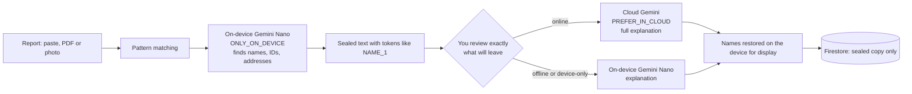

# Sealed

**Understand your medical report without giving up your identity.**

Live demo: https://rishinavroop22.github.io/sealed/

Sealed is a web app for patients and families. It reads a lab report or prescription with an AI model that runs inside the browser, removes everything that identifies the person, shows exactly what is left, and only then sends that sealed version to a cloud model for a full plain-language explanation. In device-only mode, or with no network, nothing is sent at all.

Built for [#BuildHybridAI 2026](https://firebasehybridaihackathon.devpost.com/) with **Firebase AI Logic hybrid inference**.

## The problem

People increasingly paste lab reports into AI chatbots to understand them. Those reports carry a full name, date of birth, phone number, address, hospital ID and doctor's name, all sent to a server along with the person's health data. Most people either accept that or go without an explanation.

## Why hybrid matters here

In most hybrid apps the cloud is a fallback. In Sealed, the split between device and cloud **is** the product: the on-device model is the privacy gate in front of the cloud model.



| Step | Firebase AI Logic mode | Where it runs | Why |
|---|---|---|---|
| Read a photo or scanned PDF | `ONLY_ON_DEVICE` | Gemini Nano in Chrome | The image is never uploaded. |
| Find and remove identifiers | `ONLY_ON_DEVICE` | Gemini Nano in Chrome | The raw report must never leave the device, so there is deliberately no cloud fallback. |
| Full explanation | `PREFER_IN_CLOUD` | Cloud, else device | The larger model gives the best explanation and supports Indian languages, but only ever sees sealed text. Offline, the device model answers instead. |
| Quick questions | `PREFER_ON_DEVICE` (Remote Config) | Device, else cloud | Private, free and offline; falls back to the cloud on devices without a local model. |
| Device-only mode | `ONLY_ON_DEVICE` for everything | Device | For anyone who wants nothing sent at all. |

Every answer is labelled with where it ran (from `response.inferenceSource`), and the **privacy ledger** shows the exact text of anything sent to the cloud.

## Features

- Paste text, choose a PDF, or take a photo of a report
- Two-layer sealing: pattern matching for fixed formats (phone, email, Aadhaar, PAN, labelled IDs) plus the on-device model for free-form names
- Review screen: see the sealed text, un-hide or hide more before anything is sent
- Range check: the code compares every value with its reference range and corrects any low/normal/high label a model gets wrong
- On-device answers never name a disease or cause; they say what a test measures and whether the value is in range
- Explanation in English, Hindi, Telugu, Tamil, Kannada, Malayalam, Marathi, Bengali or Gujarati
- Names restored on the device for display; the cloud only ever sees tokens
- Device-only mode and offline mode
- Private history: anonymous account, sealed copies only in Firestore; the key that restores names stays in the browser
- Installable, works offline after the first visit

## Firebase products used

| Product | Use |
|---|---|
| Firebase AI Logic | All model calls, on-device and cloud, through one SDK (`web/js/firebase.js`) |
| App Check | reCAPTCHA Enterprise on the hosted site, debug provider on localhost |
| Remote Config | `cloud_model` and `quick_route` change without a release |
| Authentication | Anonymous sign-in: a private account with no name or email |
| Cloud Firestore | Saved history, sealed text only, per-user security rules (`firestore.rules`) |

## What stays on the device

| Data | Device | Cloud |
|---|---|---|
| Original report, photo or PDF | Yes | Never |
| Names, IDs, contact details, address | Yes | Never |
| Sealed text | Yes | Only when you ask for a cloud explanation or save |
| Key that maps tokens back to names | Yes (browser storage) | Never |

## Run it locally

Requirements: Chrome 139 or later on desktop, with `chrome://flags/#prompt-api-for-gemini-nano-multimodal-input` enabled for on-device AI.

```
python -m http.server 5173 --directory web
```

Open http://localhost:5173. On Windows you can double-click `start-local.bat` instead.

On localhost the page shows an App Check debug token at the bottom. Register it in the Firebase console under App Check > Apps > Manage debug tokens to enable cloud calls. To use your own Firebase project, replace the values in `web/js/firebase-config.js` and deploy `firestore.rules`.

## Project layout

```
web/index.html          the app
web/css/app.css         styles
web/js/firebase.js      Firebase, App Check, Remote Config and the hybrid models
web/js/redact.js        sealing logic (pure functions)
web/js/ingest.js        PDF and photo reading, on the device
web/js/store.js         anonymous sign-in and sealed history
web/js/app.js           UI flow and privacy ledger
web/sw.js               offline cache
firestore.rules         per-user security rules
android/                Android version (Kotlin, Jetpack Compose)
```

## Limitations

- On-device inference needs desktop Chrome with Gemini Nano. Other browsers fall back to pattern matching for sealing and are told so plainly.
- Sealing is a strong aid, not a guarantee. The review step exists because a model can miss an identifier.
- On-device explanations are English only; Indian-language explanations come from the cloud model.
- Sealed explains reports; it does not diagnose and is not a substitute for a doctor.

## How it was built

Written with an AI coding assistant (Claude), with Firebase setup done in the Firebase console. All code was written during the contest period.

## License

Apache 2.0. See [LICENSE](LICENSE).
